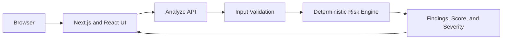

<div align="center">

# VibeX Shield

### Pause before you click, pay, share, or run.

**A defensive cyber-safety workspace for checking suspicious links, scam messages, and risky code.**

[](https://nextjs.org/)
[](https://react.dev/)
[](https://developer.mozilla.org/en-US/docs/Web/JavaScript)
[](#why-vibex-shield)

[Overview](#why-vibex-shield) · [Features](#what-it-does) · [Architecture](#how-it-works) · [Quick start](#quick-start) · [Documentation](#documentation)

</div>

---

## Why VibeX Shield?

People increasingly receive links, messages, payment requests, OTP requests and code snippets that look legitimate at first glance.

The problem is not always a lack of technical knowledge. It is the few seconds between **receiving something suspicious** and **acting on it**.

**VibeX Shield is built around that pause.**

It gives a user one place to inspect suspicious content, explains the signals that contributed to the risk assessment, and recommends safer next steps.

> Not just a red warning. A defensive explanation of **what looks risky, why it matters, and what to do next**.

## What it does

<table>
<tr>
<td width="50%" valign="top">

### Link Scanner
- Inspect suspicious URLs.
- Detect insecure HTTP usage.
- Flag common URL shorteners.
- Detect suspicious domains and TLD patterns.
- Identify obfuscation such as `@` and punycode.
- Detect credential, payment and lure language in URLs.

</td>
<td width="50%" valign="top">

### Scam Message Check
- Analyze SMS, chat and email-style messages.
- Detect urgency and pressure tactics.
- Identify OTP, PIN, CVV and banking references.
- Flag payment or financial-action requests.
- Detect reward, lottery and cashback lures.
- Identify impersonation and account-pressure language.

</td>
</tr>
<tr>
<td width="50%" valign="top">

### Code Guard
- Inspect pasted code defensively.
- Detect exposed credentials and secrets.
- Flag dangerous execution patterns.
- Detect insecure HTTP requests.
- Identify disabled TLS verification.
- Surface risky browser credential access.

</td>
<td width="50%" valign="top">

### Explainable Risk
- Generate a 0–100 risk score.
- Classify results as Low, Medium or High.
- Show the individual findings behind the score.
- Provide safer next-step recommendations.
- Keep the analysis deterministic and explainable.
- Import supported text files directly in the browser (maximum 5,000 characters).
- Restore complete results from the current browser session.
- Copy findings or download a report that excludes the submitted payload.
- Enforce input limits before analysis.

</td>
</tr>
</table>

## Automatic protection modules

VibeX Shield now includes three deployable defensive components in addition to the web dashboard:

| Module | Automatic action | Where it runs |
|---|---|---|
| Browser Link Guard | Highlights suspicious URLs and interrupts high-risk link clicks with a warning | Chrome / Edge extension |
| Code Guard | Scans source/config files for high-confidence hard-coded credentials and fails CI when found | Local Node.js + GitHub Actions |
| Factory Sensor Agent | Checks authenticated sensor readings against configured limits and sudden-change rules | Local factory gateway / edge computer |

Setup, commands, telemetry example and safety boundaries: [Automatic Protection Guide](docs/AUTOMATIC_PROTECTION.md).

The browser module is heuristic and local. The sensor agent reports anomalies; it does not stop machinery or operate a PLC. Voice-clone verification requires a dedicated audio anti-spoof model and native call/audio integration, which are not included in this browser app. The message analyzer flags UPI collect/PIN-to-receive wording and explains the debit risk.

## How it works



The current MVP sends analysis input to its own Next.js API route and runs a deterministic JavaScript rules engine. It does not call an external AI or threat-intelligence provider, and the app does not persist submitted content. Imported files are read as text in the browser; the file itself is not uploaded.

That makes the first layer:

- **Fast** — no external model call is required.
- **Explainable** — every score is backed by explicit rules.
- **Predictable** — the same input produces the same assessment.
- **Safer by design** — the MVP does not execute submitted code or fetch submitted URLs server-side.

Future intelligence layers can be added without making the deterministic safety layer dependent on an external model.

## Risk model

| Result | Score | Meaning |
|---|---:|---|
| **Low** | 0–39 | No major high-confidence warning pattern detected. |
| **Medium** | 40–69 | One or more meaningful warning signals were detected. |
| **High** | 70–100 | Multiple or high-impact risk signals were detected. |

The score is an advisory signal, not a guarantee that content is safe or malicious.

## Product experience

The main workspace is intentionally compact:

- Choose **Link Scanner**, **Scam Message Check**, or **Code Guard**.
- Paste or enter the content you want to inspect.
- Load a safe demo example when presenting the project.
- Run the analysis.
- Review the score, severity, findings and recommendations.
- Clear the current session history when needed.

The interface is designed for a quick **inspect → understand → decide** flow rather than a long security report.

## Tech stack

| Layer | Technology |
|---|---|
| Framework | Next.js 16 |
| UI | React 19 |
| Language | JavaScript |
| Icons | Lucide React |
| Analysis | Deterministic JavaScript rules engine |
| API | Next.js Route Handler |
| Styling | CSS |
| Testing | Node.js built-in test runner |
| Product runtime | Unified JavaScript launcher for dashboard and optional local sensor agent |
| Protection modules | Chrome/Edge extension, CI Code Guard, factory sensor agent |
| Deployment | Next.js-compatible host for dashboard; local gateway for sensor agent |

## Quick start — one product

### 1. Get the product

Requires **Node.js 20 or newer** and npm.

```bash
git clone https://github.com/aayush-as69/vibex.git
cd vibex
npm install
```

### 2. Configure optional factory monitoring

Copy `.env.example` to `.env.local`. Generate a private token with Node.js:

```bash
node -e "console.log(require('node:crypto').randomBytes(32).toString('hex'))"
```

Put the generated value in `SENSOR_API_TOKEN` in `.env.local`. Keep this file private and never commit it. The dashboard and other protection modules work without the sensor token; the factory agent is optional.

### 3. Run the complete local product

```bash
npm run shield -- up
```

Open **http://localhost:3000**. This single command starts the dashboard and, when a valid sensor token is configured, the local Factory Sensor Agent. Press **Ctrl+C** to stop the services.

### 4. Check installation and run protection tools

```bash
npm run shield -- doctor
npm run shield -- guard
npm test
```

CI runs the same checks on every push and pull request to `main`: `npm test`, `npm run guard`, `npm run lint` and `npm run build`. Run all four locally before opening a pull request.

### 5. Install browser protection once

```bash
npm run shield -- extension
```

Then open `chrome://extensions` or `edge://extensions`, enable Developer mode, and select the repository's `browser-extension` folder using **Load unpacked**. This is a one-time browser installation; it is shipped inside the same product archive.

### Other launcher commands

| Command | Purpose |
|---|---|
| `npm run shield -- up` | Start dashboard + configured local sensor service |
| `npm run shield -- up --prod` | Start the production dashboard + configured sensor service (run `npm run build` first) |
| `npm run shield -- doctor` | Check the installed product |
| `npm run shield -- guard` | Run the Code Guard scan |
| `npm run shield -- sensor` | Start only the factory sensor agent |
| `npm run shield -- extension` | Show browser extension installation steps |
| `npm run guard` | Direct Code Guard command |

The modules share one repository, release archive, setup guide and product launcher. Browser Link Guard is activated once in the browser; Code Guard is automatically included in CI; the sensor agent runs locally when configured.

## Demo walkthrough

For a short judge/demo flow:

1. Open **VibeX Shield**.
2. Select **Scam Message Check**.
3. Load the demo example.
4. Run the analysis.
5. Show the risk score and explainable findings.
6. Switch to **Link Scanner** and inspect a suspicious URL.
7. Switch to **Code Guard** and demonstrate a risky code snippet.
8. Explain that the MVP uses a deterministic local-first engine and does not execute submitted code.

The strongest demo is not simply showing a red score. Explain **which signal was detected and what safer action the user should take**.

## Repository map

```text
vibex/
├── app/
│   ├── api/
│   │   ├── analyze/       # Analysis API
│   │   ├── health/        # Health endpoint
│   │   └── sensors/       # Proxy to the local sensor agent's alerts
│   ├── error.js           # Runtime error boundary
│   ├── globals.css        # Application styling
│   ├── layout.js          # Root layout and metadata
│   └── page.js            # Main Shield workspace
├── bin/
│   └── vibex.js           # Unified launcher (npm run shield -- <command>)
├── browser-extension/     # Browser Link Guard (Chrome / Edge, Manifest V3)
├── sensor-agent/
│   └── server.js          # Authenticated Factory Sensor Agent
├── lib/
│   ├── risk-engine.js     # Deterministic cyber-risk analysis
│   └── sensor-guard.js    # Sensor limit and sudden-change rules
├── scripts/
│   └── code-guard.js      # Hard-coded credential scanner
├── tests/
│   ├── code-guard.test.js
│   ├── risk-engine.test.js
│   └── sensor-guard.test.js
├── docs/
│   ├── ARCHITECTURE.md
│   ├── AUTOMATIC_PROTECTION.md
│   ├── BUILD_PLAN.md
│   ├── PRODUCT_GUIDE.md
│   └── SECURITY.md
├── .github/workflows/     # CI (tests, Code Guard, lint, build) and release packaging
├── next.config.mjs        # Security headers
├── eslint.config.mjs
├── package.json
└── .env.example
```

## Documentation

Product setup, operation and safety details are kept in `docs/`.

| If you want to | Read |
|---|---|
| Install and run the complete product | [Product guide](docs/PRODUCT_GUIDE.md) |
| Understand the architecture | [Architecture](docs/ARCHITECTURE.md) |
| Install the browser and factory modules | [Automatic protection](docs/AUTOMATIC_PROTECTION.md) |
| Review security boundaries | [Security](docs/SECURITY.md) |
| See the phased roadmap | [Build plan](docs/BUILD_PLAN.md) |

## Security and limitations

VibeX Shield is a defensive analysis tool. It does not claim to provide definitive malware detection or threat attribution.

The current MVP intentionally:

- Does not execute submitted code.
- Does not make server-side requests to submitted URLs.
- Does not persist submitted analysis content.
- Limits analysis input to a bounded size.
- Uses explicit deterministic rules for its first analysis layer.
- Treats recommendations as advisory.

Before production use, the project should add appropriate rate limiting, abuse controls, stronger threat-intelligence integration, accessibility/E2E coverage, dependency monitoring, and a carefully isolated URL reputation/fetching service if remote inspection is introduced.

## Roadmap

The project is being developed in phases:

**Phase 0 — Foundation**
- Product scope and defensive guardrails.
- Next.js application foundation.
- Initial architecture and documentation.

**Phase 1 — MVP**
- Link, message and code analysis.
- Explainable findings and risk score.
- API validation.
- Demo examples and session history.
- Responsive interface and automated tests.

**Phase 2 — Intelligence**
- URL reputation and redirect analysis.
- OCR for scam screenshots and QR-payment requests.
- Optional structured LLM classification.
- Confidence and evidence scoring.
- Hindi/English explanations.
- Threat-intelligence integration.

**Phase 3 — Protection**
- Browser/share-sheet workflows.
- Malicious-link warning experience.
- Evidence/report export.
- Rate limiting and abuse protection.
- Privacy-aware telemetry.

**Phase 4 — Advanced safety**
- Voice-scam indicators.
- Repository secret/dependency scanning.
- Safer remediation workflows.
- Production security hardening.

**Phase 5 — Submission and deployment**
- End-to-end testing.
- Accessibility review.
- Deployment validation.
- Judge/demo preparation.
- Architecture and threat-model documentation.

## Contributing

1. Keep the analysis defensive and explainable.
2. Never execute user-submitted code as part of analysis.
3. Keep external integrations isolated from the core safety engine.
4. Add tests for security-sensitive behavior.
5. Update the relevant documentation when behavior changes.
6. Do not commit API keys, credentials or real user data.

## Acknowledgements

Built for **VibeX Codes — Track 3: Cyber Safety**.

The project is designed as a practical, explainable cyber-safety layer for everyday users rather than a replacement for professional security tooling.

---

<div align="center">

**VibeX Shield — pause before you act.**

<sub>Inspect. Understand. Decide.</sub>

</div>
