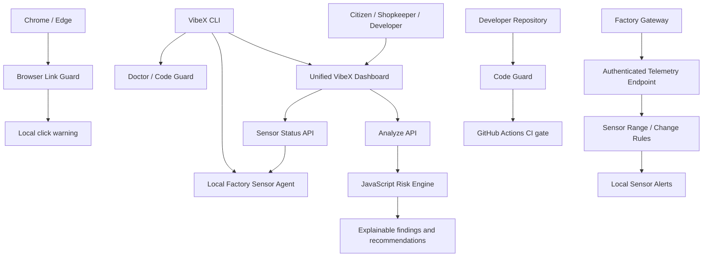

# VibeX Shield — Unified Product Architecture

VibeX Shield is released as one product with several runtime components. The launcher, dashboard, browser extension, code scanner and factory agent are maintained and packaged together, but each runs at the boundary where it can actually provide protection.



## One product, multiple execution boundaries

| Component | Runtime | Role |
|---|---|---|
| Unified dashboard | Next.js / React | Citizen, shopkeeper and developer analysis console |
| JavaScript Risk Engine | Next.js API route | URL, message, UPI wording and code-risk findings |
| Browser Link Guard | Chrome / Edge Manifest V3 extension | Local link checks and high-risk click interruption |
| Code Guard | Node.js CLI + GitHub Actions | Credential-pattern scanning and CI failure on supported findings |
| Factory Sensor Agent | Standalone Node.js service | Authenticated telemetry intake, range checks and recent-change alerts |
| Unified launcher | Node.js CLI | Starts the dashboard and configured local sensor agent; provides diagnostics and subcommands |

## Unified local startup

Run `npm install`, optionally configure `.env.local`, then execute:

```bash
npm run shield -- up
```

The launcher starts the Next.js dashboard and starts the sensor agent only when a sufficiently long `SENSOR_API_TOKEN` is configured. The dashboard's `/api/sensors` route reads the local agent's status and recent alerts.

The Browser Link Guard must be installed once through Chrome/Edge's **Load unpacked** workflow. Code Guard runs locally and in GitHub Actions. These modules are shipped in the same source ZIP and documented in [Product Guide](PRODUCT_GUIDE.md).

## Data flow and boundaries

- Submitted web analysis is sent to the app's own `/api/analyze` route and processed by deterministic JavaScript rules. It is not sent to an external LLM or threat-intelligence API.
- Browser Link Guard evaluates link URL structure in the browser; it does not upload browsing history or page content.
- Code Guard reads repository source/config files and reports the file/line/rule without printing detected secret values.
- Sensor Agent accepts JSON telemetry over a bearer-token-protected local endpoint. Recent samples and alerts are kept in bounded in-memory collections.
- No component executes user-supplied code, autonomously fixes arbitrary files, authenticates a caller's voice, or actuates factory machinery.

## Detection categories

- **URL:** HTTPS, shortened domains, suspicious suffixes, punycode, obfuscation, local/private destinations, impersonation and credential/payment lures.
- **Messages:** urgency, financial pressure, UPI collect requests, PIN-to-receive wording, OTP/PIN/CVV requests, action prompts, reward lures, impersonation and embedded links.
- **Code:** credential exposure, provider tokens, unsafe execution patterns, insecure HTTP and disabled TLS verification.
- **Factory telemetry:** configured metric bounds, unit mismatch and sudden changes relative to recent readings.

## Future intelligence layer

External URL reputation, OCR, voice anti-spoof models, native call/payment integrations and deeper SAST/SCA require separate, validated services. They must not override deterministic high-confidence findings. See the [Build Plan](BUILD_PLAN.md) for work that remains.
